<a href="https://fireflysoftware.io/openplatform/">
<picture>
  <source media="(max-width: 640px) and (prefers-color-scheme: dark)" srcset="https://raw.githubusercontent.com/fireflysoftwaresolutions/.github/main/profile/assets/banner-narrow-dark.svg">
  <source media="(max-width: 640px)" srcset="https://raw.githubusercontent.com/fireflysoftwaresolutions/.github/main/profile/assets/banner-narrow-light.svg">
  <source media="(prefers-color-scheme: dark)" srcset="https://raw.githubusercontent.com/fireflysoftwaresolutions/.github/main/profile/assets/banner-dark.svg">
  
</picture>
</a>

# Firefly OpenPlatform - Core Insurance - Underwriting

Developed by the Firefly Software Foundation. [dev@fireflysoftware.io](mailto:dev@fireflysoftware.io)

[Website](https://fireflysoftware.io/) · [OpenPlatform](https://fireflysoftware.io/openplatform/) · [Module catalogue](https://fireflysoftware.io/openplatform/modules/)

Core repository for underwriting submissions, evidence references, referrals, and decisions.

Repository: [https://github.com/firefly-oss/core-insurance-underwriting](https://github.com/firefly-oss/core-insurance-underwriting)

Stores the underwriting file. It does not rate a risk and it does not decide authority. The applicant is a party, the product is a catalog id, and a bound decision may point at a policy id.

This is a **core** service. It owns its tables and exposes a reactive API. It does not call other core services. Domain orchestration is intentionally not in this repository.

A submission follows an explicit status lifecycle. `RECEIVED` may become `IN_CLEARANCE`, `DECLINED`, or `WITHDRAWN`. `IN_CLEARANCE` may become `REFERRED`, `QUOTED`, `DECLINED`, or `WITHDRAWN`. `REFERRED` may return to `IN_CLEARANCE` or become `QUOTED`, `DECLINED`, or `WITHDRAWN`. `QUOTED` may become `BOUND`, `DECLINED`, or `WITHDRAWN`. `BOUND`, `DECLINED`, and `WITHDRAWN` stay on file. Only a `RECEIVED` submission can be removed. A submission that has left intake stays on file.

The [quote foundation](docs/quote-foundation.md) adds immutable terms, local acceptance rules, canonical bytes, and an unregistered sandbox property calculator. It does not add quote routes, storage, or policy binding.

## What it does not own

- The applicant record. partyId points at core-common-customer-mgmt.
- Product configuration and price. productId points at core-common-product-mgmt. Rating systems stay behind an adapter.
- Evidence files. documentId points at core-common-document-mgmt.
- Distributor records. distributorId points at core-common-distributor-mgmt.
- The policy written when a decision is bound. boundPolicyId points at core-insurance-policies.
- Rules execution. This service records the referral and the decision the insurer's authority produced.

Cross-service identifiers are UUID columns without a database foreign key. A missing party, contract, product, document, distributor, policy, claim, or payment order is not enforced here. The domain layer, when it exists, is responsible for that coordination.

## Module structure

| Module | Purpose |
|--------|---------|
| `core-insurance-underwriting-interfaces` | DTOs and enums |
| `core-insurance-underwriting-models` | R2DBC entities, repositories, Flyway migrations |
| `core-insurance-underwriting-core` | Services and MapStruct mappers |
| `core-insurance-underwriting-web` | Spring Boot application and REST controllers |
| `core-insurance-underwriting-sdk` | Reactive Java client generated from the OpenAPI document |

## Data model

```mermaid
erDiagram
    SUBMISSION {
        uuid submission_id PK
        uuid tenant_id
        varchar(64) submission_number
        uuid party_id
        uuid product_id
        uuid distributor_id
        uuid contract_id
        submission_status_enum submission_status
        line_of_business_enum line_of_business
        timestamp received_at
        varchar(3) currency
    }
    SUBMISSION ||--o{ SUBMISSION_RISK : contains
    SUBMISSION_RISK {
        uuid submission_risk_id PK
        uuid submission_id FK
        varchar(64) risk_number
        text description
        insured_object_type_enum insured_object_type
        uuid party_id
    }
    SUBMISSION ||--o{ UNDERWRITING_EVIDENCE : contains
    UNDERWRITING_EVIDENCE {
        uuid underwriting_evidence_id PK
        uuid submission_id FK
        uuid document_id
        evidence_type_enum evidence_type
        evidence_status_enum evidence_status
        timestamp received_at
    }
    SUBMISSION ||--o{ REFERRAL : contains
    REFERRAL {
        uuid referral_id PK
        uuid submission_id FK
        text reason
        varchar(100) authority_level
        referral_status_enum referral_status
        timestamp referred_at
    }
    SUBMISSION ||--o{ UNDERWRITING_DECISION : contains
    UNDERWRITING_DECISION {
        uuid underwriting_decision_id PK
        uuid submission_id FK
        decision_outcome_enum decision_outcome
        text conditions
        timestamp decided_at
        varchar(200) authority_reference
        uuid bound_policy_id
    }
    SUBMISSION ||--o{ SUBMISSION_STATUS_HISTORY : contains
    SUBMISSION_STATUS_HISTORY {
        uuid submission_status_history_id PK
        uuid submission_id FK
        submission_status_enum submission_status
        varchar(500) status_reason
        timestamp changed_at
    }
    SUBMISSION ||--o{ CLEARANCE : contains
    CLEARANCE {
        uuid clearance_id PK
        uuid submission_id FK
        clearance_status_enum clearance_status
        uuid in_force_policy_id
        uuid broker_of_record_party_id
        timestamp cleared_at
    }
    SUBMISSION ||--o{ SANCTIONS_SCREEN : contains
    SANCTIONS_SCREEN {
        uuid sanctions_screen_id PK
        uuid submission_id FK
        uuid party_id
        screening_status_enum screening_status
        varchar(128) provider_reference
        timestamp screened_at
    }
    SUBMISSION ||--o{ STATEMENT_OF_VALUE : contains
    STATEMENT_OF_VALUE {
        uuid statement_of_value_id PK
        uuid submission_id FK
        integer line_number
        varchar(128) location_reference
        varchar(128) occupancy
        decimal declared_value
        varchar(3) currency
        varchar(128) source_reference
    }
    SUBMISSION ||--o{ LOSS_RUN : contains
    LOSS_RUN {
        uuid loss_run_id PK
        uuid submission_id FK
        varchar(255) prior_carrier_name
        line_of_business_enum line_of_business
        integer loss_year
        varchar(64) cause_code
        integer claim_count
        decimal incurred_amount
        varchar(3) currency
        boolean large_loss
    }
    SUBMISSION ||--o{ QUOTE : contains
    QUOTE {
        uuid quote_id PK
        uuid submission_id FK
        varchar(64) quote_number
        quote_status_enum quote_status
        decimal premium_amount
        varchar(3) currency
        date valid_until
        uuid bound_policy_id
    }
    SUBMISSION ||--o{ SUBJECTIVITY : contains
    SUBJECTIVITY {
        uuid subjectivity_id PK
        uuid submission_id FK
        uuid quote_id FK
        text description
        subjectivity_status_enum subjectivity_status
        date due_date
    }
```



Fields that point at another Firefly service are logical references. Foreign keys exist only inside this database.

## API

| Method | Path | Purpose |
|--------|------|---------|
| POST | `/api/v1/submissions/filter` | Filter submissions |
| POST | `/api/v1/submissions` | Create a Submission |
| GET | `/api/v1/submissions/{submissionId}` | Get a Submission |
| PUT | `/api/v1/submissions/{submissionId}` | Update a Submission |
| DELETE | `/api/v1/submissions/{submissionId}` | Delete a submission still at intake |
| POST | `/api/v1/submissions/{submissionId}/risks/filter` | Filter submissionrisks |
| POST | `/api/v1/submissions/{submissionId}/risks` | Create a SubmissionRisk |
| GET | `/api/v1/submissions/{submissionId}/risks/{submissionRiskId}` | Get a SubmissionRisk |
| PUT | `/api/v1/submissions/{submissionId}/risks/{submissionRiskId}` | Update a SubmissionRisk |
| DELETE | `/api/v1/submissions/{submissionId}/risks/{submissionRiskId}` | Delete a SubmissionRisk |
| POST | `/api/v1/submissions/{submissionId}/evidence/filter` | Filter underwritingevidenceitems |
| POST | `/api/v1/submissions/{submissionId}/evidence` | Create a UnderwritingEvidence |
| GET | `/api/v1/submissions/{submissionId}/evidence/{underwritingEvidenceId}` | Get a UnderwritingEvidence |
| PUT | `/api/v1/submissions/{submissionId}/evidence/{underwritingEvidenceId}` | Update a UnderwritingEvidence |
| DELETE | `/api/v1/submissions/{submissionId}/evidence/{underwritingEvidenceId}` | Delete a UnderwritingEvidence |
| POST | `/api/v1/submissions/{submissionId}/referrals/filter` | Filter referrals |
| POST | `/api/v1/submissions/{submissionId}/referrals` | Create a Referral |
| GET | `/api/v1/submissions/{submissionId}/referrals/{referralId}` | Get a Referral |
| PUT | `/api/v1/submissions/{submissionId}/referrals/{referralId}` | Update a Referral |
| DELETE | `/api/v1/submissions/{submissionId}/referrals/{referralId}` | Delete a Referral |
| POST | `/api/v1/submissions/{submissionId}/decisions/filter` | Filter underwritingdecisions |
| POST | `/api/v1/submissions/{submissionId}/decisions` | Create a UnderwritingDecision |
| GET | `/api/v1/submissions/{submissionId}/decisions/{underwritingDecisionId}` | Get a UnderwritingDecision |
| PUT | `/api/v1/submissions/{submissionId}/decisions/{underwritingDecisionId}` | Update a UnderwritingDecision |
| DELETE | `/api/v1/submissions/{submissionId}/decisions/{underwritingDecisionId}` | Delete a UnderwritingDecision |
| POST | `/api/v1/submissions/{submissionId}/status-history/filter` | Filter submissionstatushistories |
| POST | `/api/v1/submissions/{submissionId}/status-history` | Create a SubmissionStatusHistory |
| GET | `/api/v1/submissions/{submissionId}/status-history/{submissionStatusHistoryId}` | Get a SubmissionStatusHistory |
| PUT | `/api/v1/submissions/{submissionId}/status-history/{submissionStatusHistoryId}` | Update a SubmissionStatusHistory |
| DELETE | `/api/v1/submissions/{submissionId}/status-history/{submissionStatusHistoryId}` | Delete a SubmissionStatusHistory |
| POST | `/api/v1/submissions/{submissionId}/clearances/filter` | Filter clearances |
| POST | `/api/v1/submissions/{submissionId}/clearances` | Create a Clearance |
| GET | `/api/v1/submissions/{submissionId}/clearances/{clearanceId}` | Get a Clearance |
| PUT | `/api/v1/submissions/{submissionId}/clearances/{clearanceId}` | Update a Clearance |
| DELETE | `/api/v1/submissions/{submissionId}/clearances/{clearanceId}` | Delete a Clearance |
| POST | `/api/v1/submissions/{submissionId}/sanctions-screens/filter` | Filter sanctionsscreens |
| POST | `/api/v1/submissions/{submissionId}/sanctions-screens` | Create a SanctionsScreen |
| GET | `/api/v1/submissions/{submissionId}/sanctions-screens/{sanctionsScreenId}` | Get a SanctionsScreen |
| PUT | `/api/v1/submissions/{submissionId}/sanctions-screens/{sanctionsScreenId}` | Update a SanctionsScreen |
| DELETE | `/api/v1/submissions/{submissionId}/sanctions-screens/{sanctionsScreenId}` | Delete a SanctionsScreen |
| POST | `/api/v1/submissions/{submissionId}/statements-of-value/filter` | Filter statementsofvalue |
| POST | `/api/v1/submissions/{submissionId}/statements-of-value` | Create a StatementOfValue |
| GET | `/api/v1/submissions/{submissionId}/statements-of-value/{statementOfValueId}` | Get a StatementOfValue |
| PUT | `/api/v1/submissions/{submissionId}/statements-of-value/{statementOfValueId}` | Update a StatementOfValue |
| DELETE | `/api/v1/submissions/{submissionId}/statements-of-value/{statementOfValueId}` | Delete a StatementOfValue |
| POST | `/api/v1/submissions/{submissionId}/loss-runs/filter` | Filter lossruns |
| POST | `/api/v1/submissions/{submissionId}/loss-runs` | Create a LossRun |
| GET | `/api/v1/submissions/{submissionId}/loss-runs/{lossRunId}` | Get a LossRun |
| PUT | `/api/v1/submissions/{submissionId}/loss-runs/{lossRunId}` | Update a LossRun |
| DELETE | `/api/v1/submissions/{submissionId}/loss-runs/{lossRunId}` | Delete a LossRun |
| POST | `/api/v1/submissions/{submissionId}/quotes/filter` | Filter quotes |
| POST | `/api/v1/submissions/{submissionId}/quotes` | Create a Quote |
| GET | `/api/v1/submissions/{submissionId}/quotes/{quoteId}` | Get a Quote |
| PUT | `/api/v1/submissions/{submissionId}/quotes/{quoteId}` | Update a Quote |
| DELETE | `/api/v1/submissions/{submissionId}/quotes/{quoteId}` | Delete a Quote |
| POST | `/api/v1/submissions/{submissionId}/subjectivities/filter` | Filter subjectivities |
| POST | `/api/v1/submissions/{submissionId}/subjectivities` | Create a Subjectivity |
| GET | `/api/v1/submissions/{submissionId}/subjectivities/{subjectivityId}` | Get a Subjectivity |
| PUT | `/api/v1/submissions/{submissionId}/subjectivities/{subjectivityId}` | Update a Subjectivity |
| DELETE | `/api/v1/submissions/{submissionId}/subjectivities/{subjectivityId}` | Delete a Subjectivity |

Missing rows return HTTP 404 through `ResourceNotFoundException`. A child row whose parent id does not match the path also returns 404.

Swagger UI: `/swagger-ui.html`. OpenAPI: `/v3/api-docs`.

## Configuration

| Variable | Description |
|----------|-------------|
| `DB_HOST` | PostgreSQL host |
| `DB_PORT` | PostgreSQL port |
| `DB_NAME` | Database name |
| `DB_USERNAME` | Database user |
| `DB_PASSWORD` | Database password |
| `DB_SSL_MODE` | `disable`, `require`, or another PostgreSQL SSL mode |
| `SERVER_ADDRESS` | Bind address, default `localhost` |
| `SERVER_PORT` | HTTP port, default `8080` |

Create an empty database before the first start. Flyway applies `db/migration` on boot.

## Build and run

```bash
mvn clean verify
mvn -pl core-insurance-underwriting-web spring-boot:run
```

Java 25 and Maven 3.9 or newer. The parent POM is `io.fireflysoftware:firefly-parent:26.10.1`.

## Stack

Java 25, Spring Boot WebFlux, virtual threads, Spring Data R2DBC, PostgreSQL, Flyway, MapStruct, SpringDoc, Micrometer Prometheus.

## Actuator

| Endpoint | Purpose |
|----------|---------|
| `/actuator/health` | Liveness and readiness |
| `/actuator/info` | Build information |
| `/actuator/prometheus` | Metrics |

## Publisher

| | |
|--|--|
| Developed by | Firefly Software Foundation |
| Development contact | dev@fireflysoftware.io |
| Platform | https://openplatform.fireflysoftware.io |
| Website | https://fireflysoftware.io |
